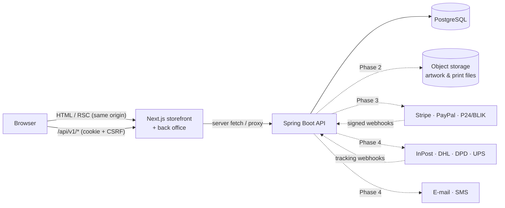
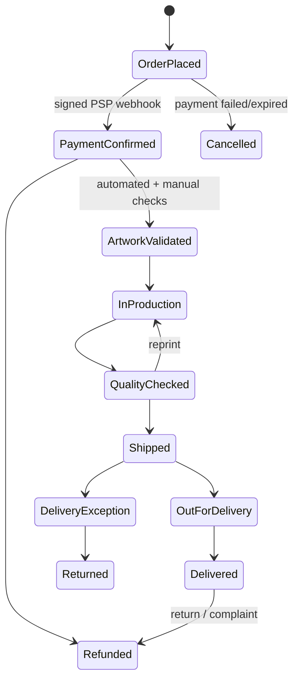

# Architecture

## System overview

* **One origin for the browser.** The Next.js server proxies `/api/v1/*` to Spring Boot
  (`frontend/src/app/api/[...path]/route.ts`). The session cookie stays `HttpOnly` + `SameSite=Lax`, and no CORS is
  needed. In production a load balancer may route `/api/*` straight to the backend instead — nothing else changes.
* **Backend is the source of truth** for prices, stock, permissions and every business rule. The frontend only
  renders and collects input.

## Backend modules (`com.musfyr.print`)

| Package | Responsibility |
| --- | --- |
| `catalog` | Products, variants (SKU = colour × size), colours, categories, collections, option groups, print areas, print methods. Read model (`CatalogQueryService`, JDBC + PostgreSQL FTS) and admin write model (`ProductAdminService`, JPA). |
| `identity` | Users, roles, login with lockout, JWT issuing, session cookie, CSRF wiring. |
| `audit` | Append-only audit log written in the same transaction as the change. |
| `marketing` | Promotions (display), newsletter double opt-in capture. |
| `quotes` | Bulk / corporate quote requests and pipeline. |
| `reviews` | Read side for moderated reviews. |
| `storefront`, `site` | Homepage aggregate endpoint; public brand/market config. |
| `common` | Problem-detail errors, correlation ids, pagination, money, rate limiting. |

Each module follows *controller → service → repository / JDBC*, with DTO records at the edge and Bean Validation on
every input. Upcoming modules (`design`, `sizing`, `pricing`, `cart`, `checkout`, `payments`, `orders`,
`production`, `shipping`, `notifications`) slot in as sibling packages and can later be split into services along
the same seams.

## Key technical decisions

| Decision | Why |
| --- | --- |
| **Money as `BIGINT` minor units + ISO currency** | No floating-point rounding; zero-decimal currencies supported. |
| **CQRS-lite**: JPA for writes, hand-written SQL for storefront reads | Listing/search is the hottest path; SQL gives FTS ranking, trigram typo tolerance and one-query colour hydration. |
| **PostgreSQL full-text + `pg_trgm`** instead of a search engine | Good enough for thousands of products with zero extra infrastructure. Swap behind `CatalogQueryService` for OpenSearch/Meilisearch when needed. |
| **Stateless JWT in an `HttpOnly` cookie + double-submit CSRF** | XSS cannot read the token; CSRF protection stays on for cookie sessions. API clients may use `Authorization: Bearer`. The cookie filter runs *before* the CSRF filter on purpose — see `SessionCookieAuthenticationFilter` (a regression test covers this). |
| **Optimistic locking** (`@Version`) on products/variants | Two admins cannot silently overwrite each other; API returns 409. |
| **Flyway, seed data in a separate location** | `db/migration` runs everywhere; `db/seed` only in `dev`/`test`. |
| **Next.js Cache Components with request-time catalogue fetches** | Static shell + streamed data; builds never need a running backend; backend Caffeine cache absorbs load. |
| **Brand/market via configuration** | `app.brand.*`, `app.commerce.*` (backend) and `NEXT_PUBLIC_*` (frontend). See BRANDING.md. |
| **RFC 9457 problem details + `X-Request-Id`** | Consistent errors for every client; support can trace a request across logs. |

## Request flow examples

**Storefront product page** — `GET /products/classic-unisex-tee` → Next renders the static shell immediately →
inside `<Suspense>` the server calls `GET /api/v1/catalog/products/classic-unisex-tee` → Spring returns the cached
`ProductDetail` (variants, availability band, options, print areas) → HTML streams in.

**Admin edits a product** — browser `PUT /api/v1/admin/products/{id}` with cookie + `X-XSRF-TOKEN` → proxy →
CSRF check → cookie JWT authenticated → URL rule (staff) → `@PreAuthorize` (ADMIN/DESIGNER) → version check →
update + audit row in one transaction → storefront caches evicted.

## Business workflows (target state)

Production status and shipping status are tracked separately; an order is never marked paid from a frontend
redirect — only from a verified, idempotently processed payment webhook (Phase 3).

## Known limitations (Phase 1)

* Rate limiting and caches are in-memory (single instance). Move to Redis before running multiple backend replicas.
* JWTs cannot be revoked before expiry (2 h); refresh tokens + server-side revocation arrive with customer accounts in Phase 3.
* A missing product renders the not-found page with `noindex`, but returns HTTP 200 because the page shell has
  already streamed (a Next.js streaming trade-off). Search engines treat it as a soft 404.
* Product imagery uses vector illustrations until photography / 3D renders are uploaded.
