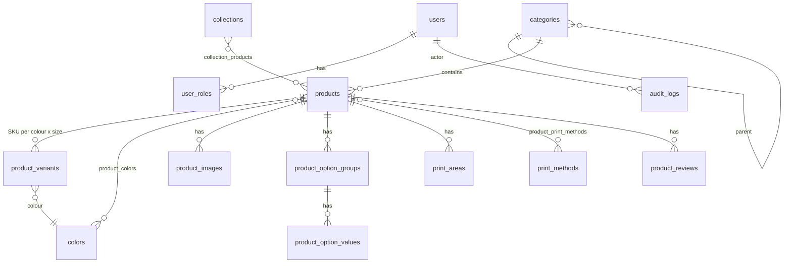

# Database

PostgreSQL 16, managed by Flyway (`backend/src/main/resources/db/migration`). Hibernate runs with
`ddl-auto=validate`, so the application refuses to start if code and schema drift apart.

| Table | Notes |
| --- | --- |
| `products` | `base_price_minor` + `currency`; `status` DRAFT/ACTIVE/ARCHIVED; `tags TEXT[]` (GIN); generated `search_vector` (GIN); trigram index on `name`; `version` for optimistic locking; `model_key` links to the 3D asset. |
| `product_variants` | Unique `sku`; unique `(product_id, color_id, size_code)`; optional `price_minor` override; `stock_quantity` with `track_inventory`. `size_code` is the **supplier's** label — regional labels and measurements are layered on in the sizing module (Phase 2) and never silently converted. |
| `print_areas` | Physical size in mm, safe margin, minimum DPI and surcharge per zone — used by the editor, validation and print-file generation. |
| `print_methods` / `product_print_methods` | Which methods (DTG, DTF, screen, HTV, sublimation, digital sticker) each product supports. |
| `product_option_groups/values` | Generic priced options (finish, material, shape…), so new product types need no schema change. |
| `promotions` | Display data now; redemption rules enforced by the pricing service in Phase 3. |
| `newsletter_subscriptions` | Stores consent text + timestamp (GDPR evidence); `PENDING_CONFIRMATION` until double opt-in. |
| `quote_requests` | Bulk/corporate leads with a human-friendly `reference`. |
| `audit_logs` | Who/what/when/IP/correlation id, JSONB details. |

E-mail columns are stored lower-case and protected by unique indexes on `lower(email)`.

## Migrations policy

* Never edit a migration that has run in a shared environment — add a new `V<n>__*.sql`.
* Seed/demo data lives in `db/seed` (`V1000+`) and is only enabled for `dev` and `test`.
* Integration tests run `flyway clean` + `migrate` once per Spring context against `musfyr_test`.
